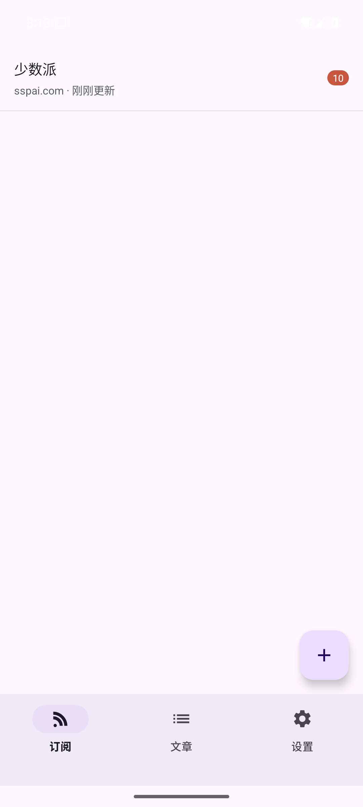

# 阅流 RSS —— 本地优先的 RSS 阅读器

> 课程项目：《Android 移动终端应用开发技术》（2 学分）主 App + 《移动互联网应用开发实战》（1 学分）伴生模块。
> 主 App：**B3 RSS 阅读器**；伴生模块：**P6 备份与恢复**。



## 一句话定位

原生 Android 实现、可离线阅读、支持自动备份与恢复的 RSS 阅读器 —— 订阅与文章全部落在手机本地，断网也能读已缓存内容。

## 功能

**主 App（5 个界面，覆盖「列表 → 详情」）**

- 订阅管理：添加订阅（地址校验、抓取预览、4 个推荐源）、未读数徽标、长按取消订阅
- 文章列表：推荐 / 未读 / 收藏三档筛选、已读置灰、星标收藏
- 文章阅读：WebView 渲染正文、图片自适应、深色模式、分享、浏览器打开原文
- 后台刷新：WorkManager 每 6 小时联网刷新，失败按源健康度指数退避
- 新文章通知：Android 13+ 运行时权限，**被拒绝后刷新与阅读完全不受影响**
- 推荐排序：收藏 / 未读 / 源健康度加权 + 时间衰减，本地纯函数计算

**伴生模块 P6（独立可启动）**

- 一键备份到本机、导出 JSON（SAF）、从文件恢复
- 合并式恢复：按 `url` / `link` 去重，可选覆盖阅读与收藏状态
- 每日自动备份（WorkManager），只保留最近 7 份
- 独立桌面图标 + 应用快捷方式 + FileProvider 分享

## 技术栈

| 层 | 选型 |
|---|---|
| 语言 / UI | Java 17 + XML View（原生 Android，非跨平台） |
| 架构 | MVVM：Activity/Fragment → ViewModel → Repository → Room / 网络 |
| 异步 | ViewModel + LiveData + ExecutorService（Java 下替代协程） |
| 持久化 | Room 2.6.1 + SharedPreferences |
| 网络 | OkHttp 4.12.0 |
| XML 解析 | Android 内置 XmlPullParser（RSS 2.0 + Atom 双格式） |
| 后台任务 | WorkManager 2.9.1 |
| 构建 | Gradle 8.9 + AGP 8.7.3，compileSdk/targetSdk 35，minSdk 24 |

## 目录结构

```
app/src/main/java/com/mobile/rssreader/
├── data/
│   ├── entity/        Room 实体（Feed、Article、FeedWithUnread）
│   ├── dao/           数据访问（含未读数子查询）
│   ├── net/           RssFetcher、RssParser、NetworkErrorMapper
│   ├── repo/          FeedRepository、ArticleRepository
│   └── prefs/         偏好设置
├── logic/             自定义算法（ArticleRanker、FeedHealth），纯函数可单测
├── work/              RefreshWorker、RefreshScheduler
├── notify/            NotificationHelper（含权限降级）
├── backup/            伴生模块核心（BackupPayload、BackupManager、AutoBackupWorker）
├── ui/                界面层（feeds / articles / detail / settings / backup）
└── util/              线程池、日期、HTML、结果与事件封装
```

## 构建与运行

环境要求：JDK 17+（实测 21）、Android SDK platform 35、Gradle 8.9。

```bash
./gradlew assembleDebug                        # 构建
adb install -r app/build/outputs/apk/debug/app-debug.apk
./gradlew testDebugUnitTest                    # 30 个单元测试
```

> 仓库内 `settings.gradle` 已配置 Maven 阿里云镜像、`gradle-wrapper.properties` 指向腾讯镜像，
> 避免国内网络拉取 Google Maven 长时间卡住。

## 测试

- **单元测试 30 个**（`RssParser` / `DateUtils` / `HtmlUtils` / `ArticleRanker` / `FeedHealth` / `BackupPayload`），全部通过
- **手工用例 12 项**：添加订阅、双格式解析、断网错误态、三档筛选、星标/已读联动、深色模式、通知权限拒绝与授权、备份、恢复、独立入口

## 文档

| 文件 | 内容 |
|---|---|
| `202405100113-邬逸帆-开发文档.pdf` | 开发文档（10 章：需求 / 系统 / 数据库 / 接口 / 关键实现 / 伴生模块 / 界面 / 测试 / 总结 / 附录） |
| `202405100113-邬逸帆-项目汇报.pptx` | 汇报 PPT（10 页） |
| [docs/录屏脚本与水印方案.md](docs/录屏脚本与水印方案.md) | 两段 3 分钟录屏的分镜脚本 + 水印实现说明 |
| [docs/代码问答卷.md](docs/代码问答卷.md) | 20 个问答提纲（含代码位置） |
| [docs/用户测试模板.md](docs/用户测试模板.md) | 用户测试报告模板（找 3–5 人试用后填写） |
| [docs/项目信息.md](docs/项目信息.md) | 作者信息、交付物命名、水印规范 |
| [docs/环境说明.md](docs/环境说明.md) | 本机环境与镜像配置、模拟器说明 |

## 演示水印

界面左下角常驻 `202405100113 邬逸帆`（半透明黑底），可在设置页关闭。实现见 `ui/widget/WatermarkOverlay.java`。

## 作者

| 项 | 内容 |
|---|---|
| 姓名 | 邬逸帆 |
| 学号 | 202405100113 |
| 班级 | 物联网 241 |
| 指导教师 | 邱景 |
| 仓库 | https://github.com/xu2hou/RSS |

Git 提交按功能切片，格式为 `<type>: <中文说明>`（feat / fix / test / docs / chore），提交作者为本人 GitHub 账号 `XuZhou`（与中文姓名同一人）。
